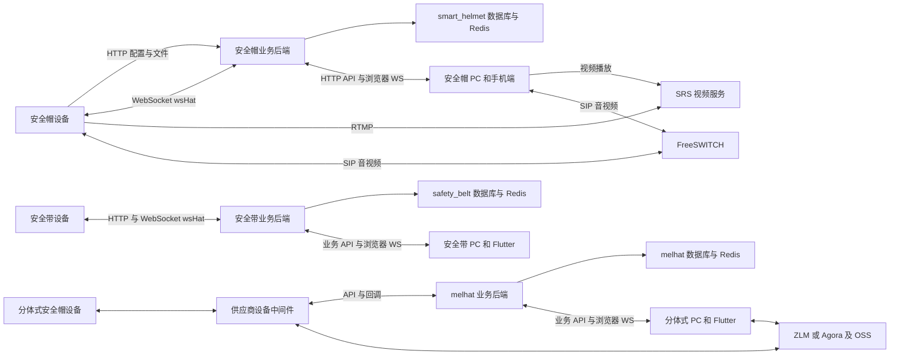

# 安全帽安全带设备对接交接资料分析

本报告面向接手开发和运维的团队，分析交接目录中的源码、接口文档、数据库、账号说明和调试工具。分析日期为 2026 年 10 月 21 日。

**结论：这些材料足以帮助我们理解现有系统并继续开发，但还不足以认定已经完成可独立部署、可稳定运行的技术交接。** 交付物实际是三套业务系统的源码快照、三份数据库备份和若干设备协议资料。核心链路已有实现，同时存在模拟功能、前后端接口不一致、设备控制串发、固定历史轨迹入库以及生产部署资料缺口。

当前宜确认“已收到材料，正在核对与联调”，不宜仅凭目录、截图或页面成功提示确认“全部功能完成验收”。这一判断针对本次交付内容，不代表已证明线上环境发生过相同故障。

## 阅读范围和交付组成

源目录：`D:/沉积岩/智能穿戴平台相关文档/安全帽安全带设备对接/`。

全目录共 **7,770 个文件，529,662,616 字节，约 505 MiB**。其中 Git 元数据 3,721 个，其他交付文件 4,049 个。全部文件完成字节读取、哈希和类型登记，未出现读取失败。按扩展名识别的文本有 3,231 个、681,177 行，含源码、锁文件、SQL 和历史日志；另外有二进制依赖、图片、字体和 Office/PDF 资源。

两份 PDF 共 57 页，已逐页提取阅读，并对关键协议和表格页面进行图像核对；9 份 DOCX、14 份 XLSX 全部提取正文、表格及单元格内容。源码按三个系统分别审查，重点精读业务入口、设备消息、落库、控制、音视频、前端实际调用和构建配置。重复框架、第三方库、生成模板按结构与规则扫描。**全量文件读取不等于全部代码逐行逻辑审计，也不等于编译、测试或真机验收通过。**

| 交付区域 | 非 Git 文件数 | 实际内容 |
| --- | ---: | --- |
| 安全帽 | 1,211 | Java 服务端、Vue PC、Android 手机协助与 SIP 客户端、账号文本 |
| 安全带 | 1,198 | Java 服务端、Vue PC、Flutter 手机端、平台账号说明和配置截图 |
| 分体式安全帽 | 1,575 | Java 业务服务端、Vue PC、Flutter 手机端、供应商中间件 API 与 WebRTC 示例 |
| QtScrcpy 工具目录 | 59 | Windows 投屏工具、ADB、DLL、scrcpy-server、键位及配置；内有重复工具目录 |
| 根目录及公共材料 | 6 | 三份 SQL、日志抓取说明、FreeSWITCH 笔记、39 页设备接口 PDF |

三套 Java 后端均沿用若依 3.8.5、Java 8、Spring Boot 2.5.14 体系，前端均属 Vue 3 体系，但具体依赖版本与构建工具并不完全相同。它们不是一个已经完成统一设备、用户、告警及音视频模型的平台。

安全帽目录的 Android 工程主要用于手机端人员协助和 SIP 拨号；两套 Flutter 工程主要是业务管理客户端。**不能把这些 App 源码当作已经交付了安全帽或安全带的完整硬件固件。** 厂家固件、设备型号与版本的对应关系、升级包及设备配置权限仍要单独交接。

完整文件路径及 SHA-256 见 [全部文件清单](D:/沉积岩/anquanchuandai/交接分析/全部文件清单.csv)。三个系统的详细证据分别见 [安全帽分析](D:/沉积岩/anquanchuandai/交接分析/安全帽分析.md)、[安全带分析](D:/沉积岩/anquanchuandai/交接分析/安全带分析.md)、[分体式安全帽分析](D:/沉积岩/anquanchuandai/交接分析/分体式安全帽分析.md)。

## 三套系统如何连接

该图概括源码和文档中的主要链路，不代表已经探测了线上网络。安全带后端还保留 FreeSWITCH、媒体、文件服务等复用代码，哪些功能属于正式交付范围需要明确。

### 安全帽和安全带

设备开机先取得配置，得到 `api_url` 和 `ws_url`。随后连 `/wsHat`，发送 `ca_login`；登录成功后，上报 `ca_report_location`、`ca_sos`、`ca_sip_sos` 等 JSON 消息。Java 后端写数据库、更新在线状态，并将位置和告警推给浏览器。

安全帽的主要业务表是 `tab_secure_hat`、`tab_secure_hat_location_record`、`tab_sos`。安全带主链路已经改用 `tab_box`、`tab_box_location_record`、`tab_alarm_sos`，但部分查询和补传仍保留旧安全帽表引用。命名中仍出现 hat/melhat 本身不能证明代码有错，必须沿实际调用和 SQL 判断。

安全帽的监控主要是设备 RTMP → SRS → 浏览器 FLV；通话另走 FreeSWITCH/SIP。收到业务数据、看到视频、完成双向通话是三条不同的验收链路，不能用其中一项成功代替全部成功。

### 分体式安全帽

`melhat_server` 是业务平台后端，通过供应商中间件 API 获取设备状态、下发 TTS、申请通话；供应商再通过 HTTP 回调把定位和告警发回来。它不是已经包含设备协议桥接、媒体中继的完整中间件。

文档中的两种媒体方案应分别验收：

- **Agora 路径**：帽间会议、群呼及云端录制，使用 App ID、频道、UID、Token 等参数。
- **ZLM WebRTC 路径**：调度台多帽听音、同一麦克风向多帽讲话；需要创建会话、拉流/推流、约 60 秒心跳续期和明确挂断。文档提示媒体面 UDP/TCP 8000 可达，信令走 HTTPS。

交付包含接口说明和 `play.html` 示例，未发现文档所引用的供应商中间件 `server/` 实现。独立部署、账户归属、设备授权、服务费用、续费和中断后的替代方案都需要交接方说明。

## 接口文档中必须保留的约定

39 页设备文档文件名含 `250916`，正文更新日期写 **2025/09/09**；中间件 API v1.7 正文写 **2026/09/23**。二者涉及不同设备接入层次，不能简单按“新文档覆盖旧文档”理解。

| 项目 | 传统设备协议 | 分体式中间件 API | 对我们接入的影响 |
| --- | --- | --- | --- |
| 标识 | device_id、user_id、SIP ID | helmetSn、uid_device、业务帽子 ID | 建立明确映射，不能混用人员 ID 和设备 ID |
| 定位坐标 | x_point 是纬度，y_point 是经度，标明 GCJ-02 | latitude/longitude 标明 WGS84 | 统一地图前标记坐标系，按需转换且避免重复转换 |
| 定位周期 | 默认约 10 秒，文档提示依固件版本变化 | 文档写每 5 秒推送 | 实机确认周期，分别设计在线和延迟判断 |
| 佩戴状态 | 0 默认、1 未佩戴、2 已佩戴 | 不可直接套用传统枚举 | 不要当成布尔值，更不能直接等同机械锁扣状态 |
| 告警类型 | 数字码，如 1 脱帽、7 SOS、11 近电 | silent、sos、removal、fall、proximity | 建立统一事件模型，保留原始类型 |
| 数据上报 | HTTP + WebSocket | 中间件 HTTP 回调 | 需要不同适配器及认证策略 |
| 媒体 | SIP；另有 RTMP/WebRTC 版本方案 | Agora 与 ZLM 并存 | 独立管理各自会话、Token、心跳和释放 |
| 时间 | 报文混有秒/毫秒及业务时间 | 文档 timestamp 示例为 Unix 秒 | 统一单位和时区，不能按字符串随意比较 |

传统文档要求配置中的 `config`、`notice_switch` 等部分字段是序列化后的 JSON 字符串，不能未经验证直接改成嵌套对象。许多开关使用 **0 开、1 关**，与常见布尔直觉相反；另一些开关又用 1 开，必须逐字段映射。

传统文档允许某些设备不处理离线补传和围栏接口，部分控制操作没有设备执行回执。即便平台“发送成功”，也不能直接显示为“设备已执行”。本包既然实现了补传入口，就需要保证启用时不会写入错误数据。

中间件文档把抓图和水印标为待开发；列表在线字段说明改为 1/0，但单设备示例仍出现布尔值。Java 回调路径与文档路径、timestamp 格式也有差异。应索取当前生产版本的脱敏实际报文和代理配置，以实际契约固定接口测试。

来源：[设备接口文档](D:/沉积岩/智能穿戴平台相关文档/安全帽安全带设备对接/帽子源码/1020源码/对接设备端接口文档250916.pdf)第 2、8、12–16、30、33–39 页；[中间件 API v1.7](D:/沉积岩/智能穿戴平台相关文档/安全帽安全带设备对接/帽子源码/1020源码/分体式安全帽/原生webrtc支持示例程序和文档/api-v1.7.pdf)第 1、3–4、7–10、12–18 页。

## 数据库交付情况

三个根目录备份合计 **130 张表、110,252 条 INSERT 数据记录**。记录数是静态解析导出 SQL 得到的，不是对线上数据库执行 COUNT 的结果；设备条目数量不等于当前在线设备数，也不自动代表全部实物资产。

| 文件 | 源 MySQL 版本 | 导出头部记载时间 | 表数 | 数据行数 | 核心数据 |
| --- | --- | --- | ---: | ---: | --- |
| melhat.sql | 8.0.42 | 2026-10-20 16:20:01 | 28 | 2,462 | 帽子档案 12、定位 18、对讲 496 |
| safety_belt.sql | 8.0.37 | 2026-10-20 16:24:34 | 30 | 3,433 | 盒子档案 8、定位 2,152、SOS 68 |
| smart_helmet.sql | 8.0.42 | 2026-10-20 16:22:42 | 72 | 104,357 | 帽子档案 7、定位 101,284、报警 1,452 |

这些导出时间没有注明时区，不将其强行换算为本次分析所在时区。

三个文件都含 `DROP TABLE` 重建和 `SET FOREIGN_KEY_CHECKS=0`，均未包含 `CREATE DATABASE`。它们应作为数据库快照审查和恢复，**不能作为现有业务库的增量升级脚本直接执行**。本次没有执行任何 SQL。

分体式后端 `sql/` 里另有 `ry_20230223.sql` 和 `quartz.sql`，分别创建 19 张若依基础表、11 张 Quartz 表。它们是框架初始化脚本，不是三份根目录业务备份的替代品。尤其旧初始化脚本会重建 `sys_user`、`sys_menu` 等表，不能在恢复业务快照后照通用手册再顺序执行。

需要关注四件事：

1. **安全带表与实际调用不齐。** 实时写 `tab_box_location_record`，部分 PC 轨迹查询和补传仍访问备份不存在的 `tab_secure_hat_location_record`。需修正实际调用或提供正确版本，不能机械地补齐所有历史残留表。
2. **SQL 不包含媒体原文件。** 附件、照片、录像和声音的 URL/路径不是文件本身；MinIO/OSS、上传目录、录像目录、地图瓦片和音频提示文件需另行交付或明确继续使用的服务。
3. **备份混有业务历史和认证配置。** 用户、设备、位置、告警、字典、菜单、日志与认证字段都有保留。报告不复述秘密或个人记录；需要交接方明确哪些数据应迁移、哪些只是测试样本。
4. **轨迹表索引与增长策略未交代。** 三套核心定位表的导出结构只见主键，未见设备加时间的辅助索引。安全帽已有十万级定位记录，应依据实际查询做 EXPLAIN、保留期和归档评估；本次没有测量查询性能，不直接断言已发生慢查询。

结构、字段与行数明细见 [数据库结构统计](D:/沉积岩/anquanchuandai/交接分析/数据库结构统计.json)。原始依据为 [melhat.sql](D:/沉积岩/智能穿戴平台相关文档/安全帽安全带设备对接/melhat.sql:24)、[safety_belt.sql](D:/沉积岩/智能穿戴平台相关文档/安全帽安全带设备对接/safety_belt.sql:1771)、[smart_helmet.sql](D:/沉积岩/智能穿戴平台相关文档/安全帽安全带设备对接/smart_helmet.sql:3216)。

## 优先解决的代码问题

以下是源码可定位的行为或契约冲突；“可能造成的影响”仍需隔离环境验证。优先级用于安排接手工作，不是线上事故认定。

| 优先级 | 范围 | 已发现事实 | 验收前处理要求 |
| --- | --- | --- | --- |
| 首先处理 | 安全帽和安全带 | 目标设备连接不可用时，会尝试将原指令发送给其他在线设备连接 | 禁止这种回退；用两台以上设备验证离线目标不会串发 |
| 首先处理 | 安全带 App | SOS 函数只有延迟，没有发送动作，页面却显示“SOS 已发送” | 接入真实发送与确认；未实现时不得提示成功 |
| 首先处理 | 安全带 PC | 默认监控页地图初始化后启动模拟位置和报警；部分操作失败回退 mock 并提示成功 | 分清演示与生产，验收使用设备原始报文和真实落库 |
| 首先处理 | 安全帽和安全带 | 离线补传忽略请求 data，使用写死的历史轨迹 | 修正后测试真实离线路线、归属、时间和去重 |
| 首先处理 | 三套后端 | 设备或回调及 WS 入口匿名放行，相关处理未见完整设备/来源身份绑定 | 明确应用与网关各自认证职责，验证未授权与跨用户访问 |
| 联调阻断 | 分体式 PC | WebRTC 创建路径在后端不存在；挂断路径缺少被读取的 PathVariable；未找到可靠心跳调用 | 统一前后端契约，并覆盖长通话、挂断、退出和异常恢复 |
| 联调阻断 | 安全带 | 部分实际查询仍访问未交付的旧定位表；视频窗口 service 未注入 | 修复调用链和依赖注入，再验证真实地图与视频 |
| 构建缺口 | 安全帽 PC | 未发现 vite.config 入口，源码依赖 Vue 插件、别名和自动导入 | 补齐对应版本配置，从干净环境构建 |
| 发布缺口 | 分体式 App | 构建引用的 upload-keystore.jks 不在本子目录 | 安全交接原签名及更新兼容信息 |
| 数据正确性 | 安全帽和安全带 | 模块开关与通知开关被组装到相反 Map | 按字段逐项验证下发与设备实际行为 |
| 数据正确性 | 安全带 App | 佩戴 1/2 含义冲突，告警处理路径与状态值不同，高度字符串处理不一致 | 建字段/枚举契约，避免误显示佩戴与处理结果 |
| 数据正确性 | 分体式 | 围栏统计把围栏 ID 关联到帽子 ID；大屏位置存在固定模拟坐标 | 修正关联模型，验证越界事件和地图均来自真实设备 |

最重要的证据入口：

- 指令回退：[安全帽 MelhatWebSocketSever.java 第 208 行](D:/沉积岩/智能穿戴平台相关文档/安全帽安全带设备对接/帽子源码/1020源码/安全帽/smart_helmet_server/ruoyi-system/src/main/java/com/ruoyi/system/melhat/MelhatWebSocketSever.java:208)，[安全带同类方法第 203 行](D:/沉积岩/智能穿戴平台相关文档/安全帽安全带设备对接/帽子源码/1020源码/安全带/safety_belt_server/ruoyi-system/src/main/java/com/ruoyi/system/melhat/MelhatWebSocketSever.java:203)。是否被真实设备执行尚未实测。
- SOS 占位：[dashboard_signals.dart 第 143 行](D:/沉积岩/智能穿戴平台相关文档/安全帽安全带设备对接/帽子源码/1020源码/安全带/safety_belt_app-main/safety_belt_app-main/lib/signals/home/dashboard_signals.dart:143)，[页面成功提示第 440 行](D:/沉积岩/智能穿戴平台相关文档/安全帽安全带设备对接/帽子源码/1020源码/安全带/safety_belt_app-main/safety_belt_app-main/lib/views/home/dashboard_page.dart:440)。
- PC 模拟推送：[默认监控页第 723 行](D:/沉积岩/智能穿戴平台相关文档/安全帽安全带设备对接/帽子源码/1020源码/安全带/safety_belt_pc-main/safety_belt_pc-main/src/views/monitor/index.vue:723)。初始化调用见同文件 859 行附近；全局弹窗取决于对应全局通知函数是否存在。
- 固定轨迹：[安全帽 MelhatServiceImpl.java 第 229 行](D:/沉积岩/智能穿戴平台相关文档/安全帽安全带设备对接/帽子源码/1020源码/安全帽/smart_helmet_server/ruoyi-system/src/main/java/com/ruoyi/system/melhat/MelhatServiceImpl.java:229)。安全带同源实现还有旧表问题。
- WebRTC：[PC 创建 API 第 58 行](D:/沉积岩/智能穿戴平台相关文档/安全帽安全带设备对接/帽子源码/1020源码/分体式安全帽/melhat_pc-main/melhat_pc-main/src/api/intercom.js:58)，[后端创建接口第 147 行](D:/沉积岩/智能穿戴平台相关文档/安全帽安全带设备对接/帽子源码/1020源码/分体式安全帽/melhat_server/ruoyi-admin/src/main/java/com/ruoyi/melhat/controller/IntercomRecordController.java:147)，[挂断接口第 208 行](D:/沉积岩/智能穿戴平台相关文档/安全帽安全带设备对接/帽子源码/1020源码/分体式安全帽/melhat_server/ruoyi-admin/src/main/java/com/ruoyi/melhat/controller/IntercomRecordController.java:208)。

三份分项分析包含更多已定位问题，如上传异常仍返回成功、照片消息进入其他分支、WebSocket 清理键不一致、回调时间格式不一致、详情接口丢失结果、文件下载地址校验不足等。它们应纳入整改和测试，但不能用“所有代码都不可用”概括：设备档案、绑定、定位入库、告警列表、TTS/通话适配等也有真实实现。

## 其他附件的价值和局限

**日志抓取说明**给出了 USB/ADB、`logcat` 过滤与保存方法，以及一个内网配置地址。这是现场排障便签，不是完整设备安装、初始化、故障定位或生产运维手册。仅阅读，未连接设备或执行命令。

**FreeSWITCH 笔记**涉及 v1.10.9 源码编译、依赖、SIP、WS/WSS、ESL、RTP、NAT/ACL、会议命令等，也混有不同端口和示例凭据。它有助于理解既有音视频环境，但没有交付实际运行的用户目录、拨号计划、会议配置、证书、服务单元及完整网络映射。不能原样当作经过验证的部署脚本。

**QtScrcpy**是调试辅助工具，不是业务平台组成或帽端固件。目录还嵌套了一份同名工具包，不能据重复文件数量推断业务交付更完整。EXE/DLL/JAR/AAR 仅做盘点和哈希，不运行、不反编译，也未做恶意代码鉴定。

**三份若依环境手册内容和 SHA-256 完全相同**，是通用开发环境说明，包含旧 SQL 和旧部署步骤。不能替代本项目准确的数据库版本、发布包名称、依赖服务和启动顺序。

**Office 表格和其他 Word 文档**主要是检修工作包、巡检、技术监督、维修准备等导入/导出模板，含占位符和样例数据，说明代码复用了更大的生产管理平台。它们不是设备专用协议，也不是本次安全帽安全带功能已验收的凭证。模板中的作业和验收数值没有在本次软件交接审查中被认证为可用于现场作业的标准。

**账号文本、env/yml、签名文件和日志**属于敏感交付材料。源码中确有数据库、缓存、SIP/ESL、中间件认证、应用签名等凭据配置，部分日志代码会记录认证参数。应安全交接资产归属与凭据，在切换计划中完成轮换；不能简单删除或替换签名文件而破坏已有 App 更新。报告没有复制真实密码、密钥或人员位置。

## 需要向交接方一次性补齐的材料

| 材料 | 希望对方交付的具体内容 | 完成标准 |
| --- | --- | --- |
| 版本基线 | 三套前端、后端、App 与数据库的对应 commit/tag、发布包、SHA-256、实际部署版本 | 用收到的源码重建出可追溯版本 |
| 构建条件 | JDK/Maven/Node/包管理器/Flutter/Android SDK 确切版本及完整配置，缺失 Vite 配置和签名 | 干净机器可复现构建 |
| 硬件与固件 | 厂家、型号、设备编号清单、固件版本、升级包、配置入口、授权边界 | 每类实物均有可重复接入步骤 |
| 设备协议 | 安全带专有字段、双钩/佩戴/高度含义、告警码、时间、坐标、周期、重试/去重/回执 | 原始报文到页面逐字段核对 |
| 生产拓扑 | 域名/IP、端口、TLS、反向代理路径、WS、SIP/RTP、媒体服务、地图及回调配置 | 所有链路可由我们自行定位与恢复 |
| 数据与文件 | 数据库备份、迁移顺序、MinIO/OSS/录像/音频/地图资源及恢复记录 | 恢复后历史记录和文件均可访问 |
| 外部服务 | 分体式中间件源码或镜像/服务合同、租户与设备授权、Agora/OSS 等归属费用及停服方案 | 交接方退出后服务使用权与运维责任清晰 |
| 安全配置 | 设备认证、回调认证、用户/组织数据范围、网络限制、密钥轮换及签名归属 | 未授权访问被拒绝，合法设备可持续工作 |
| 功能范围 | 正式/模拟/待开发功能清单，已知缺陷和修复版本 | 页面显示与真实功能承诺一致 |
| 验收证据 | 真机原始报文、服务日志、数据库记录、前端展示、测试步骤与结果 | 可重复验证完整闭环，而不是只有截图 |

三个后端都带 Git 元数据；HEAD 文件分别指向安全帽 main、安全带 master、分体式 dev。这些分支名称不能证明它们就是正式验收版本，需由对方给出明确发布基线和修改状态。现有通用 README、TODO 或历史日志不能替代该证明。

## 建议的接手顺序

1. **封存交付基线。** 保留原始目录和本次哈希清单，确认合同功能范围、实物设备、外部服务及版本归属。
2. **建立隔离环境并复现构建。** 修齐缺失配置，按三套独立数据库恢复；不得先向现有生产库执行 DROP 脚本。核对对象存储和媒体文件。
3. **先修控制、SOS 和数据真实性问题。** 串发指令、假成功、模拟报警、硬编码轨迹及身份绑定是优先项；明确关闭未完成功能。
4. **逐套做单设备闭环。** 开机取配置→登录→心跳→上报→落库→页面→告警→确认处理→历史查询；每个节点保留同一设备同一事件的证据。
5. **做多设备和异常验收。** A 离线时发给 A 的命令不应到 B；覆盖断网重连、重复/乱序/离线补传、换人绑定、低电量、失败回执和文件重试。
6. **独立验收媒体。** 监控、单呼、群呼、SOS、持续通话、主动/异常挂断、恢复推流、云录/回放分别检查；分体式明确 Agora 与 WebRTC 的不同生命周期。
7. **再做统一平台整合。** 建统一设备主键、人员绑定、在线状态、原始/标准告警、坐标系及时间模型，通过三套适配器接入。不要先合并数据库或把不同协议的字段直接拼到同一张表。

本次工作只对材料做读取、提取、静态分析与本地报告整理。原始交付未修改，未执行交付脚本或 SQL，未使用账号登录外部平台，未构建或连接实物设备；因此可确认的是材料和源码中的事实，尚不能确认的是线上部署版本、服务可用性及真机行为。
